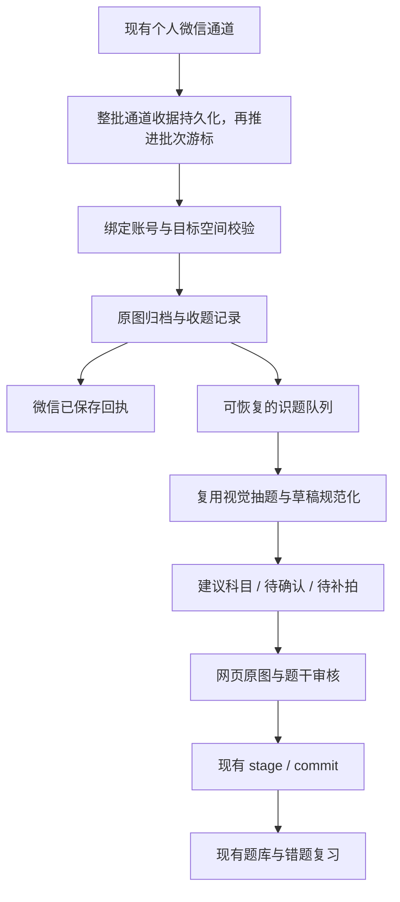

# RFC 0002：个人微信拍照收题与错题归档

- 日期：2026-10-29
- 状态：交互方案待确认，未接入生产功能
- 已确认入口：现有伙伴接入的个人微信（`weixin` / iLink），首期只做已绑定账号的私聊
- 交互原型：`web/public/prototypes/mistake-notebook-demo.html`，双击即可运行；示例状态只在当前页面内存中保存
- 延续：[RFC 0001：题库图片 / PDF 智能识别导入](0001-question-bank-ocr-import-mvp.md)

## 1. 建议与可行性

建议做，且应扩展现有题库、识题导入和伙伴微信通道。核心体验是：**在微信给学习伙伴发一张题目照片，先可靠保存原图，再按科目和首次接收时间整理；需要复习时，检查题干后加入现有错题复习。**

“归档照片”和“确认结构化题目”分开：前者自动完成，后者沿用现有审核导入。这样既满足发图即存，也不需要用模型置信度绕过 RFC 0001 的题目审核规则。没有答案也能保存，不把用户主动收集的题误记成系统已经批改判错。

第一期不需要更换微信协议、部署独立 OCR 平台或新增一个完整 Capability。收集、归属、幂等和任务恢复应由服务负责；LLM 负责识别建议，不能靠伙伴提示词决定是否真正保存。

## 2. 现有能力与主要缺口

以下是当前代码核查结果，不能仅凭旧设计文档推断已经实现。

| 能力 | 当前证据 | 本次处理 |
| --- | --- | --- |
| 个人微信接图、下载、AES 解密 | `deeptutor/partners/channels/weixin.py:709`、`:908` | 复用；补充来源时间、媒体序号及可靠接收 |
| 微信绑定站内账号 | `deeptutor/services/partners/links.py:114` | 复用 `/link` 流程；收题时必须重新解析用户和目标资料空间 |
| 图片识别、原图附件、可编辑草稿 | `deeptutor/services/practice/recognition/service.py:58`、`:350` | 复用抽题适配器、规范化和审核能力 |
| 已配置视觉模型 | `deeptutor/services/practice/recognition/extractor.py:41` | 优先复用，当前提示词面向印刷试题；手写需另测 |
| 题目审核、幂等导入、复习状态 | `deeptutor/services/practice/storage.py:390` | 复用，新增照片来源关联与主动收集来源标记 |
| 原图与草稿审核界面 | `web/components/learning/practice/RecognitionImport.tsx:18` | 扩展为从微信归档进入审核，继续确认题干 |
| 题库与错题入口 | `web/components/learning/practice/PracticePage.tsx:20` | 在 `/space/questions?view=mistakes` 增加“微信收题/待整理”；复习保留 `/learning/practice` |

需要解决的具体问题：

1. **归属**：私人会话隔离不等于个人题库隔离。`partner_content_context` 默认采用伙伴作用域或配置所有者的工作区（`services/partners/workspace_binding.py:37`）。不能直接把发图者的错题写进共享伙伴空间。
2. **不丢收题**：当前 bus 是内存队列（`partners/bus/queue.py:17`）；微信游标在逐条处理前保存（`weixin.py:693`），内存去重还在下载前标记成功。需要在推进游标前把可恢复的消息收据落盘。
3. **连续发图**：识题仓库当前同一 workspace 只允许一个进行中任务（`recognition/repository.py:34`）。必须排队，不能把连发十张图片变成九条“已有任务”。
4. **恢复与保留**：识题执行仍是 `asyncio.create_task`，存在遗留任务收敛方法，但未发现生产恢复调用。任务/预览有 24 小时 TTL；原图并非已证实随 TTL 删除。长期归档记录必须独立于这些临时任务。
5. **科目和时间**：当前分类是多对多，且混有知识点；题目创建时间是导入时刻。需要独立的主科目与首次接收时间。

## 3. 收题规则与用户流程

### 首次配置

用户在伙伴设置里开启“拍照收题”，选择目标资料空间。微信身份必须先通过现有绑定流程核验。首期私聊、一个发图账号对应一个已授权目标空间；未绑定时给出绑定引导，不写入任何共享错题库。

开启专用“拍照收题模式”后，该私聊发来的图片都先作为收题资料保存，之后再整理。识别为非题目的图片标为“非题目，待移出”，不自动建题或加入复习；用户可从归档移除。关闭模式时，普通图片正常聊天；“加入错题本”或 `/错题` 可作为单次明确收集指令。这样保存先于识别，普通照片不会被模型直接当成正式错题。原型里的收题开关代表演示设置，不会变更真实伙伴配置。

### 一次发图

1. 接收整批消息，持久化该批全部通道收据和可恢复媒体来源后才推进批次游标；首次接收时解析并冻结发图账号对应的目标用户和资料空间。
2. 下载并校验图片，在归档附件中保存原图。只有保存完成后才回复“原图已保存”。
3. 异步识别题干和建议科目；UI 立刻能查到这次收题，不必等待模型完成。
4. 清晰、单一科目的照片显示在建议科目下，标注分类可修改；科目不明进入“待确认”，模糊图片进入“待补拍”。
5. 多道题可以拆成多个草稿并共用一张原图，上传事件仍只有一次；第一期不承诺精确裁题。
6. 在网页详情检查/编辑题干，确认后用现有 `stage → commit` 加入错题复习。原图无答案时留空，自评或以后补充。

科目分类是可逆的资料整理，不代表题干已被审核。模型建议的解析、答案和错因不得伪装成原图内容；错因由用户补充，AI 建议需独立标识。

### 异常行为

| 情况 | 用户看到的结果 | 系统规则 |
| --- | --- | --- |
| 同一消息重投 | 原有记录，不多出一题 | 消息幂等键拦截，不增加再次上传次数 |
| 用户再次发送同一原图 | “已收录，已记录这次上传” | 新收据关联既有图片/题目；保留两次收题时间 |
| 图片相似但字节不同 | 可提示疑似重复 | 首期不自动合并；不得仅靠感知 hash 删除用户资料 |
| 科目不明或跨科 | 原图已保存，待选科目/逐题调整 | 允许“未分类”，不强行归入数学 |
| 模糊、遮挡或识别失败 | 原图仍在，可补拍或重试 | 重试不改首次上传时间；补拍与旧原图关联 |
| 服务重启/模型超时 | 显示排队或重试中 | worker lease 到期可恢复，限制重试次数 |
| 微信回执发送失败 | 网页仍有记录 | 回执独立重试，不能重新建题 |
| 关闭拍照收题 | 正常聊天，不自动归档 | 设置只影响之后的消息，已存照片仍保留 |

## 4. 页面与 Demo 验证范围

原型采用 DeepTutor 已有 Cream 主题的米白、陶土色和细线，正式实现使用主题变量，兼容现有 Snow / Dark 等主题。

| 页面/区域 | 功能 |
| --- | --- |
| 错题库 | 科目、上传日期、关键词和状态筛选；按上传日期分组，最新优先；来源、原图、题干摘要 |
| 微信收题演示 | 清晰单题、多题、科目不明、模糊失败、重复照片五个可点击场景；展示保存和整理状态 |
| 详情 | 原图与题干对照，编辑科目/标题/错因，区分归档与复习；示例解析默认折叠 |
| 待整理 | 科目选择、补拍、重试；不影响原图留存 |
| 收题设置 | 演示伙伴、个人微信、收题开关、归档策略、目标空间和时间规则 |

本地选择图片仅用于预览，**不会上传、不会调用 OCR，也不会连接真实微信**。原型数据刷新即重置。页面展示题目、解析、拆题与状态迁移用于确认交互，不构成模型准确率或微信联调证据。

本轮优先确认：是否接受默认“发图即存原图”；科目不明确时是否只需网页补确认；多题是否需要拆成独立题；归档后是否必须立即进入复习。当前推荐是“先自动归档，确认后进入复习”。

## 5. 实现架构

建议新增 `deeptutor/services/practice/photo_ingestion/` 深模块，对外提供 `ingest / list / update / retry / confirm` 业务操作。Partner runtime 在身份解析后调用，不在 `weixin.py` 内写题库业务。通道层必须另补整批接收收据与来源字段，业务层再写照片归档记录；只在 Partner runtime 新增收据已晚于当前游标推进及媒体下载，无法覆盖其故障窗口。新增收集服务不应绕行一次 LLM 对话才能完成保存。

可恢复队列首期使用 SQLite + 唯一键 + worker lease + 指数退避即可。串行调度同一用户/workspace 的识题任务，复用现有限流，不直接承诺横向扩展。明确区分收据已持久化、媒体下载成功和归档成功，失败时文案不得提前声称已保存原图。

媒体下载需要可恢复来源描述。`get_updates_buf` 对应整个返回批次，因此须先将该批所有待处理消息及媒体来源写入通道 inbox，再保存下一游标；不能每处理一张照片就推进整批游标。模型进程和通道轮询解耦。敏感媒体凭据只保存在受保护的通道存储中，不出现在网页、日志和导出文件。消息至少处理一次，通过幂等实现一次归档效果。

通道幂等键采用稳定的 `partner_id + channel_account_id + channel + sender_id + external_message_id + media_index`，不包含可重新绑定的站内用户。首次接收冻结 owner/workspace（未绑定则标明未绑定、不自动归档），重放和重试只校验原目标权限，不根据新的 `/link` 绑定转移旧消息。缺失可靠消息 ID 时须保留来源 seq/时间与稳定载荷摘要，并明确降级去重能力。

### 数据建议

| 数据 | 关键字段与约束 |
| --- | --- |
| `channel_inbox_events` | 稳定通道账号、partner/channel/sender/message/media 标识、批次、可恢复媒体来源、首次收到时间及冻结的 owner/workspace；通道稳定标识唯一，不随站内重绑定变化 |
| `photo_receipts` | channel_event_id 唯一引用、冻结的 user/workspace、source_sent_at、received_at、asset_id、status、错误、回执状态；一条通道事件最多一条业务归档 |
| `photo_assets` 或现有附件引用扩展 | 原图稳定标识、内容 SHA-256、MIME、字节/像素校验、所有者、保留状态；同用户同字节可复用，跨用户不得暴露资源 |
| `photo_question_links` | receipt ↔ draft/entry、题目序号、可选 bbox；支持一图多题、一题多次上传 |
| 题目/草稿补充 | subject_id、subject_source、subject_review_status、first_uploaded_at、source=partner_chat、mistake_origin=self_reported |
| 待处理任务 | 当前阶段、attempts、next_retry_at、lease_until、版本；与现有识题 job 关联 |

subject 使用受限枚举（语文、数学、英语、物理、化学、生物、历史、地理、道法、其他、未分类），知识点继续使用 tags。多学科图片允许不同草稿各自归类。科目建议可以和抽题在同一次视觉请求中返回；模型置信度仅用于复核提示，不能作为正式题库自动提交依据。

### “按科目和上传时间保存”的定义

- 默认上传时间 = 服务端首次收到消息的 `received_at`；另存微信原始发送时间。统一以 UTC 存储，按用户时区展示，本次默认 `Asia/Shanghai`。
- 分类和列表始终按首次上传时间，不按识别结束/导入/重试时间；详情可查看再次上传记录。
- 界面可展示“数学 → 2026年10月 → 10月29日”。原图物理位置用稳定 asset id，科目和日期作为索引；改科目无需搬文件或失效 URL。
- 若以后增加文件导出，可以生成 `数学/2026-10-29/错题编号.jpg`。导出不列入本期必须范围。
- 归档照片不跟随识题预览的 24 小时 TTL 消失；删除归档和删除正式题目分别说明。共享原图需引用计数，避免删一题就损坏同图其他题。

微信永久归档原图的生命周期覆盖 RFC 0001 §9.4 的临时原图删除规则：同图多题共享的是不可变的归档 asset，不是识题任务的可变附件记录。原有导入流程的临时原图清理不能删除永久归档资产。

### API 与现有审核链路

建议在现有 practice 路由下扩展 `/photo-inbox` 查询、详情、编辑和重试接口；微信收集直接调用领域服务，不伪造 HTTP 请求。每次读写沿用当前用户和 workspace 权限校验。照片入站记录与正式题目分表保存，列表可统一展示但应有清楚状态。

确认题目时复用 `/import/recognize/{job_id}/stage` 和 `/import/commit` 的版本检查、答案来源约束和提交幂等，但需要扩展其上下文和提交事务，不能直接调用后即认为照片来源已打通：

- 通过经权限校验的 receipt/job 引用，在服务端传递受信任的照片来源、科目、首次上传时间。当前 stage 不会保留这些新增字段，需要补充传递和持久化。
- 当前 commit 固定写 `source=import`，`target=mistakes` 还固定写 `result=incorrect`。照片收集分支应保留 `source=partner_chat`、`mistake_origin=self_reported` 和 `result=ungraded`，通过独立复习状态纳入错题，而不伪造系统判错。需要检查现有 SQL 触发器和统计口径的兼容。
- 目前 commit 响应只有计数，需要新增/保存 `draft_id → entry_id` 映射，并在同一题库事务内幂等写入 receipt/entry 关联；内容 hash 合并时也返回已有 entry 映射。跨通道 inbox 的完成状态可重放收敛，不能假设跨数据库事务。

归档超出临时任务 TTL 后应能从永久原图重新生成审核任务。重新生成的草稿通过归档项的既有提交映射对齐，避免仅凭新 job ID 再次导入。

## 6. GitHub 技术参考

2026-10-29 已通过 GitHub CLI 搜索并读取上游代码，同时浏览公开文档核查。以下是参考方向，不表示本轮已经引入这些依赖。

| 项目 | 参考内容 | 适用边界与本期选择 |
| --- | --- | --- |
| [Tencent/openclaw-weixin](https://github.com/Tencent/openclaw-weixin) | [媒体下载与解密](https://github.com/Tencent/openclaw-weixin/blob/main/src/media/media-download.ts)、[协议说明](https://github.com/Tencent/openclaw-weixin/blob/main/docs/protocol.md)；代码 [MIT](https://github.com/Tencent/openclaw-weixin/blob/main/LICENSE) | 与现有 iLink 匹配，参考媒体兼容与上下文处理。其 [monitor](https://github.com/Tencent/openclaw-weixin/blob/main/src/monitor/monitor.ts) 也在逐条处理前保存游标，不能据此保证归档不丢；仍需新增持久收据 |
| [PaddleOCR / PP-StructureV3](https://github.com/PaddlePaddle/PaddleOCR/blob/main/docs/version3.x/pipeline_usage/PP-StructureV3.en.md) | 整页布局框、文字、公式和 JSON/Markdown；代码 [Apache-2.0](https://github.com/PaddlePaddle/PaddleOCR/blob/main/LICENSE) | 作为复杂整页图的可选增强。布局块不等于题目，仍需合并题干/选项/插图并复核；首期不强制部署 |
| [Pix2Text](https://github.com/breezedeus/Pix2Text) | [recognize_formula / recognize_text_formula](https://github.com/breezedeus/Pix2Text/blob/main/pix2text/pix_to_text.py)：公式区转 LaTeX、混排识别；代码 [MIT](https://github.com/breezedeus/Pix2Text/blob/main/LICENSE) | 可作为数学公式识别对照。代码授权不能推及全部模型/依赖；[模型文档](https://pix2text.readthedocs.io/zh-cn/stable/models/) 中高级模型有不同授权。无需为公式单独引入完整文档栈 |
| [wttwins/wrong-notebook](https://github.com/wttwins/wrong-notebook) | 科目、时间、标签和掌握状态；[ErrorItem 数据模型](https://github.com/wttwins/wrong-notebook/blob/main/prisma/schema.prisma) 保留用户、原图和结构题 | 功能组织参考；本次未发现根目录 LICENSE，不复制源码或素材，也不作为可直接引入的依赖 |

推荐顺序：**现有视觉抽题器 → 真实照片评估 → 必要时增加布局/公式 OCR 适配器**。PaddleOCR 与 Pix2Text 都不直接负责微信消息可靠接收、个人归属、错因判定和错题归档。公式示例与文档解析 benchmark 也不能推导整页中文手写作业的准确率。

上游协议说明不是完整服务端契约；本次未发现可承诺固定 CDN 媒体有效期的第一方依据。图片应尽快下载自存，下载失败允许重试/重发，不套用公众号临时素材时长。长任务结果回执应复用当前通道上下文刷新能力并实测，网页查询始终可用。

## 7. 分期与投入估算

以下为基于代码核查的开发判断，不是排期承诺，前提是现有微信登录和视觉模型可用，且由熟悉本仓库的 1 名全栈开发承担。

| 阶段 | 交付 | 粗估 |
| --- | --- | --- |
| 交互确认 | 本次静态 Demo 与方案，确认自动保存/复习审核边界 | 本轮 |
| A：可靠收图 | 身份/资料空间、入站收据、附件、游标时序、去重与任务队列 | 3–4 个开发日 |
| B：整理与题库 | 科目/上传时间/来源、列表详情、待整理、审核导入关联 | 3–5 个开发日 |
| C：联调交付 | 微信回执、异常恢复、基本迁移与验收 | 1–3 个开发日 |
| 真实照片试用 | 至少一轮样本评估与针对性修正 | 另留 3–5 日 |

首期开发约 **7–12 个开发日**，真实照片联调另计。不纳入首期：自动批改判错、自动补写答案、去手写还原、精确裁题、相似题推荐、全套打印导出、FSRS 改造、企业微信和群聊。

成本优先由“每图一次识别，重试复用结果”控制；具体模型费用须在模型选定和样本测试后按真实图片 token/分辨率测算。本方案不引用未经测量的单图价格、准确率或响应时间。

## 8. 验收标准

1. 已绑定私聊发图，先产生可查询的原图归档；识别失败、草稿过期均不丢原图。
2. 连发 10 张图正常排队；识别中重启后能够恢复，不因单 workspace 识题限制丢任务。
3. 同一消息重复投递只归档一次；用户重新发送相同原图保留新的上传事件，但不重复建题。
4. 科目修改、跨科多题和同图两题的来源关系正确；暂无题干也能看原图。
5. 23:59/00:01 的上海时间分组正确；重试、补拍和导入不覆盖首次上传时间。
6. A/B 微信用户与资料空间不能交叉读写；未绑定账号不落入伙伴共享错题。
7. 无答案留空，生成建议答案必须显式确认；原图、AI 建议和用户备注有清楚来源。
8. 微信回执失败不回滚归档、不重复导入；关闭自动收题后，无明确收题指令的新图片只走正常聊天。开启模式后非题目图片保留待移出，不进入正式题库。
9. 手动确认后继续使用现有错题复习；主动收集不污染自动判题的正确率统计。

识别评估建议准备约 100 张脱敏真实照片，覆盖印刷/手写覆盖/反光/透视/多题/跨科与数学图形。分别记录题干与公式保真、科目建议正确率、人工修正量、漏题/串题、端到端耗时和失败原因，再决定是否需要 OCR 适配器。不能用 Demo 中预设的成功结果代替此验收。
